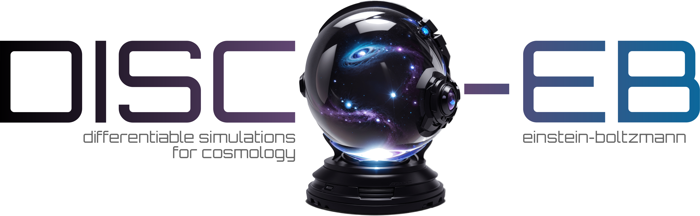

<p align="center">
  
</p>

<h1 align="center">DISCO-EB</h1>

<!--
The coverage badge reads a gist that the `tests` workflow rewrites on every
push to main. The id below is the repository variable COVERAGE_GIST_ID.
These badges sit above the `overview` snippet marker, so the documentation
site does not repeat them.
-->
<p align="center">
  <a href="https://github.com/cosmo-sims/DISCO-EB/actions/workflows/tests.yml"></a>
  <a href="https://github.com/cosmo-sims/DISCO-EB/actions/workflows/tests.yml"></a>
  <a href="https://github.com/cosmo-sims/DISCO-EB/actions/workflows/lint.yml"></a>
  <a href="https://github.com/cosmo-sims/DISCO-EB/actions/workflows/types.yml"></a>
  <a href="https://pypi.org/project/disco-eb/"></a>
  <a href="https://pypi.org/project/disco-eb/"></a>
  <a href="https://pypi.org/project/disco-eb/"></a>
  <a href="https://docs.jax.dev/"></a>
  <a href="https://arxiv.org/abs/2311.03291"></a>
  <a href="https://www.conventionalcommits.org/en/v1.0.0/"></a>
  <a href="LICENSE"></a>
</p>

<p align="center">
  <a href="#installation">Installation</a> •
  <a href="#quickstart">Quickstart</a> •
  <a href="https://cosmo-sims.github.io/DISCO-EB/">Documentation</a> •
  <a href="https://arxiv.org/abs/2311.03291">Paper</a> •
  <a href="#citation">Citation</a>
</p>

<!-- start:overview -->

DISCO-EB is a **differentiable linear Einstein-Boltzmann solver** for cosmology, and the Einstein-Boltzmann module of the DISCO-DJ framework (DIfferentiable Simulations for COsmology, Done with Jax). It evolves the background, the recombination history and the linear perturbations of every wave mode of a **batch of cosmologies in one GPU launch**. DISCO-EB supports models including: flat or curved ΛCDM, a CPL dark-energy fluid $(w_0, w_a)$ and massive neutrinos.

<!-- end:overview -->

## Installation

<!-- start:install -->

```bash
pip install "disco-eb[cuda13]"   # or [cuda12], which Python 3.10 or older GPUs need
```

A GPU is required to run the E-B solve. Whilst the matter power spectrum is included in this package, CMB observables live in a separate package, [DISCO-CMB](https://github.com/lawrenceberry/DISCO-CMB).

<!-- end:install -->

## Quickstart

<!-- start:quickstart -->

A particular cosmology is defined as an instance of a DISCO-EB cosmological model initialised with particular cosmological parameters. In the following example we set up two LCDM cosmologies and configure the solver to return the comoving curvature perturbation $\mathcal{R}$ and the CDM overdensity, for 64 wave modes at 100 scale factors:

```python
import numpy as np
from discoeb import LCDM, solve_eb

planck = LCDM.from_density_parameters(
    Omega_m=0.3142, Omega_b=0.0494, H_0=67.32,
    A_s=2.1e-9, n_s=0.966, T_cmb=2.7255, Y_He=0.2454, N_eff=3.046,
)
k = np.geomspace(1e-4, 1.0, 64)      # 1/Mpc
a = np.geomspace(1e-6, 1.0, 100)     # scale factors, the last one today

values = solve_eb([planck, planck.replace(omega_c=0.125)], k, a, keep=("R", "delta_c"))
R = values[:, 0]  # (2, 64, 100): cosmologies, wave modes, scale factors
```

Cosmologies are described by their physical density parameters, `omega_b`, `omega_c` and
`omega_de` ($\omega = \Omega h^2$), or by their density fractions, `Omega_m`, `Omega_b` and `Omega_de` ($\Omega = \rho / \rho_\text{crit}$) using `from_density_parameters`. All work is fused into a single set of ODE solves, with no background or thermal history interpolation tables. The solver is JIT-compiled and runs on the GPU, so it is fast and differentiable in the cosmological parameters. Users can choose which quantities to keep at which times, and the GPU kernel evaluates them on the fly. The integration runs using a [modax](https://github.com/lawrenceberry/modax) Rodas5P GPU kernel.

<!-- end:quickstart -->

## Development

<!-- start:development -->

The repository uses [uv](https://docs.astral.sh/uv/):

```bash
git clone https://github.com/cosmo-sims/DISCO-EB.git && cd DISCO-EB
uv sync --extra cuda13  # or --extra cuda12

uv run pytest tests -rs   # includes GPU tests, -rs shows skipped CLASS comparisons
uv run pytest tests -m "not gpu" -n auto   # host only tests, parallelised across CPU cores
uv run ruff format && uv run ruff check --fix  # format and lint
uv run ty check  # type check
uv run pre-commit install   # formatting, linting and type checking on commit
```

The documentation (Sphinx with MyST and autodoc) builds in its own environment:

```bash
export UV_PROJECT_ENVIRONMENT=.venv-docs
uv sync --no-default-groups --group docs
uv run --no-sync sphinx-autobuild docs docs/_build/html   # live preview
uv run --no-sync sphinx-build -W docs docs/_build/html    # what CI runs
```

<!-- end:development -->

## Citation

<!-- start:citation -->

If you use DISCO-EB in your research, please cite the
[JCAP article](https://doi.org/10.1088/1475-7516/2024/06/063):

```bibtex
@article{DISCO-EB:2024,
    author = "Hahn, Oliver and List, Florian and Porqueres, Natalia",
    title = "{DISCO-DJ I: a differentiable Einstein-Boltzmann solver for cosmology}",
    eprint = "2311.03291",
    archivePrefix = "arXiv",
    primaryClass = "astro-ph.CO",
    doi = "10.1088/1475-7516/2024/06/063",
    journal = "JCAP",
    volume = "06",
    pages = "063",
    year = "2024"
}
```

<!-- end:citation -->

## License

<!-- start:license -->

DISCO-EB uses the
[MIT License](https://github.com/cosmo-sims/DISCO-EB/blob/main/LICENSE). The
recombination module adapts code from
[RECFAST](https://www.astro.ubc.ca/people/scott/recfast.html), whose UBC
license is included in our version.

<!-- end:license -->
